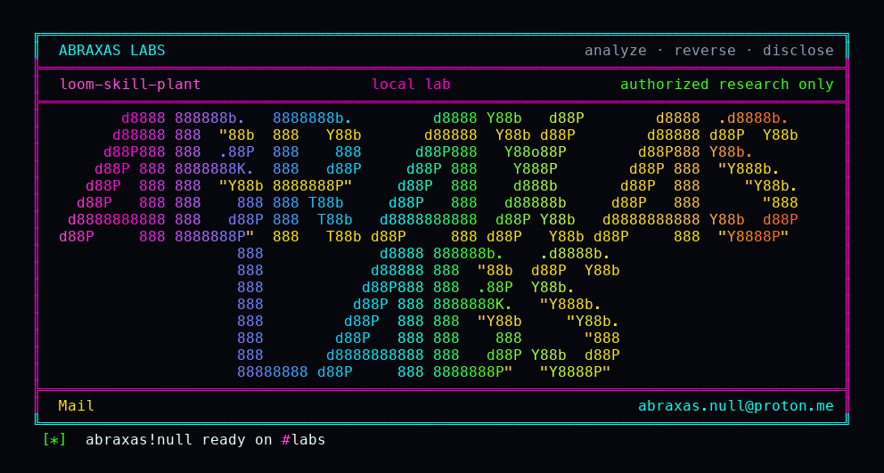

<p align="center">
  
</p>

# loom-skill-plant

A registry administrator can rewrite a skill document that Loom does not tie to a group. The next full deploy of an agent that already lists that skill copies the new text into the system prompt, including an agent in another group. The writer cannot open that agent and cannot invoke it.

Someone who can update the agent has to deploy it. A quick redeploy keeps the previous prompt. That is why the score has `UI:R`. What the agent later says back is not something this lab captured, so confidentiality is unscored.

**Class:** Instruction text injected across a group boundary
**Reach:** Remote. `registry:write` (`g-admins-demo` or `g-admins-registry`). Not super-admin.

**[Loom](https://github.com/awslabs/loom)** [v1.9.0](https://github.com/awslabs/loom/releases/tag/v1.9.0) `a3050669` and [v1.10.3](https://github.com/awslabs/loom/releases/tag/v1.10.3) `cc10ab0`

| | |
|---|---|
| ID | no CVE yet |
| Class | **Unscoped skill body folded into another group's prompt** |
| Reach | **Remote**, `registry:write`, then a full deploy |
| CWE | [CWE-863](https://cwe.mitre.org/data/definitions/863.html) / [CWE-74](https://cwe.mitre.org/data/definitions/74.html) |
| CVSS | **Medium: 6.2** `CVSS:3.1/AV:N/AC:L/PR:H/UI:R/S:C/C:N/I:H/A:N` |
| Product | [awslabs/loom](https://github.com/awslabs/loom) |
| Affected | **v1.9.0** `a3050669f5b4c83210a44ed4346f17e01641e82f` and **v1.10.3** `cc10ab08573087fa12154f7c8181ffcd985fea88` |
| Auth | `g-admins-demo` in the lab |
| License | [GNU Affero GPL v3.0](LICENSE) |
| Lab | loopback Docker on v1.9.0. v1.10.3 was a source check. |

## What an attacker can do

| Privilege | Method / sink | Impact | Lab-proven or inferred |
|---|---|---|---|
| Replace `skill_md` and approve it | `PUT /api/registry/records/{id}` then approve | Integrity of the skill record | Lab-proven. PUT 200, reapprove 200, status APPROVED, witness in the document. |
| Have that text land in another group's system prompt | `_get_attached_skill_prompt_text` on a full deploy that still names the skill | Integrity. `## Attached Skills` plus the witness. | Lab-proven on the fold. The writer is not the one deploying the victim agent. |
| Read or invoke that agent | `GET /api/agents/{id}` | Closed | Lab-proven 403 |
| Approve a linked MCP or agent record in the other group | registry approve | Closed | Lab-proven. Both 403. |

**Stays closed**

| Axis | Method / sink | Why it is closed |
|---|---|---|
| Integrity | `create_record` aimed at another group's MCP or agent id | 403 before any cloud call |
| Recon | Dependents list | Filtered by group |
| Integrity | Quick redeploy | Keeps the prompt already stored |

## How I found it

`_owned_resource_or_403` returns nothing when the registry record has no Loom row. The comment says skills stay under `registry:write`. The PUT then stores the caller's `skill_md`. The fold reads the live APPROVED document and does not compare `loom:group`.

I wanted this to be "approve their MCP record too." That path checks the linked row and returns 403. The skill path is the one that does not.

Container on v1.9.0. Both functions are still on v1.10.3. I did not re-run the container there.

## Lab

```bash
python3 loom-skill-plant-Abraxas-Labs.py
```

```text
SUCCESS LOOM-190-SKILL-PLANT unauth-me=401 me-groups=t-admin,g-admins-demo agent-get=403 skill-put=200 skill-reapprove=200 mcp-approve=403 agent-approve=403 fold-witness=yes LOOM-190-SKILL-PLANT-WITNESS
```

## The fix

Give a skill record a `loom:group`, and refuse the PUT unless the caller is in it. On fold, skip a skill whose tag is not the agent's tag.

## References

- [awslabs/loom v1.10.3](https://github.com/awslabs/loom/releases/tag/v1.10.3) `cc10ab08573087fa12154f7c8181ffcd985fea88`
- [`registry.py` `_owned_resource_or_403`](https://github.com/awslabs/loom/blob/cc10ab08573087fa12154f7c8181ffcd985fea88/backend/app/routers/registry.py#L126)
- [`agents.py` `_get_attached_skill_prompt_text`](https://github.com/awslabs/loom/blob/cc10ab08573087fa12154f7c8181ffcd985fea88/backend/app/routers/agents.py#L786)
- [CWE-863](https://cwe.mitre.org/data/definitions/863.html) · [CWE-74](https://cwe.mitre.org/data/definitions/74.html)
- [CVSS 3.1 calculator](https://www.first.org/cvss/calculator/3.1#CVSS:3.1/AV:N/AC:L/PR:H/UI:R/S:C/C:N/I:H/A:N)


## License

GNU Affero GPL v3.0. See [LICENSE](LICENSE). Loopback lab only. No warranty.

Abraxas Labs
abraxas.null@proton.me
